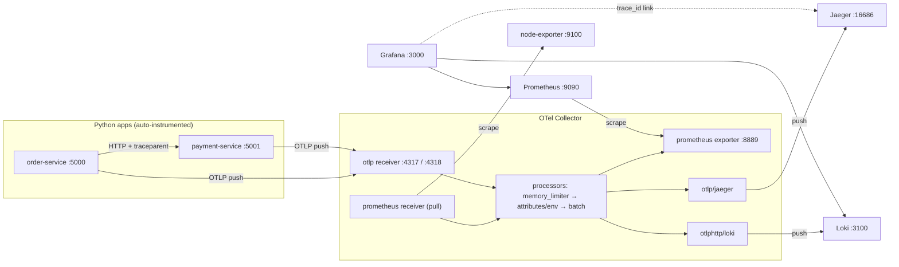

# OpenTelemetry Observability Lab: Metrics, Traces and Logs with One Collector

Learn **how OpenTelemetry works**, then run it yourself on your laptop with **Docker Compose**. Two small Python services send **metrics, traces and logs** through one **OpenTelemetry Collector** to **Prometheus, Jaeger and Loki**, and you see everything in **Grafana** and **Jaeger**, including a **one-click jump from a log line to its trace**.

📘 A step-by-step PDF guide is included: [`OpenTelemetry-Lab-Guide.pdf`](OpenTelemetry-Lab-Guide.pdf)

> No cloud account needed. Runs on Docker Desktop at **zero cost**.

---

## Contents

1. [OpenTelemetry in one minute](#1-opentelemetry-in-one-minute)
2. [Core concepts](#2-core-concepts)
3. [The OpenTelemetry Collector](#3-the-opentelemetry-collector)
4. [Tech stack: what each tool does](#4-tech-stack-what-each-tool-does)
5. [Architecture and data flow](#5-architecture-and-data-flow)
6. [How this helps in real production](#6-how-this-helps-in-real-production)
7. [Hands-on lab: step by step](#7-hands-on-lab-step-by-step)
8. [Production vs this lab](#8-production-vs-this-lab)
9. [Clean-up](#9-clean-up)

---

## 1. OpenTelemetry in one minute

When a user says *"checkout is slow"*, you need three answers:

- **Is something wrong?** → **metrics** (numbers over time)
- **Where is it slow or failing?** → **traces** (one request's path across services)
- **What exactly happened?** → **logs** (detailed messages)

**OpenTelemetry (OTel)** is the **open standard** for producing and sending all three. You instrument your app **once**, and send the data to **any** backend: Prometheus, Jaeger, Loki, Datadog, Grafana Cloud, and more.

> **Think of a universal power adapter.** Your app plugs into OpenTelemetry once, and OpenTelemetry plugs into whichever monitoring tool you choose. Switching tools no longer means changing your code.

| | Prometheus | OpenTelemetry |
|---|---|---|
| What it is | A metrics **database** + scraper + alert engine | A **standard + SDKs + Collector** for producing and **shipping** telemetry |
| Signals | Metrics | **Metrics, traces and logs** |
| Stores data? | ✅ Yes | ❌ No. It sends data to a backend |
| Typical model | **Pull** (scrapes `/metrics`) | Mostly **push** (OTLP) |

They work **together**: OpenTelemetry collects and ships, while Prometheus (and Jaeger, Loki) store and query.

---

## 2. Core concepts

### 2.1 The three signals

| Signal | What it is | Answers | Backend in this lab |
|---|---|---|---|
| **Metrics** | Numbers over time | *Is something wrong?* | **Prometheus** |
| **Traces** | One request's journey, made of **spans** | *Where is it slow or failing?* | **Jaeger** |
| **Logs** | Timestamped messages | *What exactly happened?* | **Loki** |

### 2.2 Traces and spans

```
Trace (one request, one trace_id)
└── span: order-service   GET /order        ███████████████████  414 ms
    └── span: order-service   GET (call)        ██████████████   334 ms
        └── span: payment-service GET /pay        █████████████  327 ms  ❌ 500
```

- A **span** is one unit of work, with a start time, a duration and attributes.
- Spans form a **parent → child** tree, and all of them share one **`trace_id`**.
- **Context propagation:** when `order-service` calls `payment-service`, OTel adds a **`traceparent` HTTP header**, so the second service **joins the same trace**.

### 2.3 What gets installed in an app

| Part | Role |
|---|---|
| **API** | The functions you'd call in code (`start_span`, …) |
| **SDK** | The **engine**: creates spans, metrics and logs, batches them |
| **Instrumentation libraries** | **Auto-hooks** for frameworks (Flask, requests, logging) |
| **Exporter** | **Sends** the data out (here over OTLP to the Collector) |

### 2.4 Auto vs manual instrumentation

| | Auto (this lab) | Manual |
|---|---|---|
| Code changes | **None**: run the app with `opentelemetry-instrument` | Import OTel and create spans and metrics yourself |
| You get | HTTP spans, HTTP metrics, logs with `trace_id` | Business-level detail (e.g. a `process-payment` span, an `orders_total` counter) |

Real teams use **both**: auto for the basics, manual for key business steps.

### 2.5 OTLP: the OpenTelemetry Protocol

**OTLP** is the standard **format + transport** for sending telemetry.

| Transport | Port |
|---|---|
| gRPC | **4317** |
| HTTP | **4318** |

Apps **push** OTLP to the Collector, and the Collector can **push** OTLP onward to backends.

### 2.6 Configuring apps with environment variables

The SDK reads `OTEL_*` variables, so **no addresses live in your code**:

| Variable | Meaning |
|---|---|
| `OTEL_SERVICE_NAME` | The app's name (shown in Jaeger and Grafana) |
| `OTEL_EXPORTER_OTLP_ENDPOINT` | **Where** to send: `http://otel-collector:4317` |
| `OTEL_EXPORTER_OTLP_PROTOCOL` | **How**: `grpc` or `http/protobuf` |
| `OTEL_TRACES_EXPORTER` / `OTEL_METRICS_EXPORTER` / `OTEL_LOGS_EXPORTER` | Turn each signal on (`otlp`) or off (`none`) |
| `OTEL_PYTHON_LOGGING_AUTO_INSTRUMENTATION_ENABLED` | Capture Python `logging` and attach `trace_id` / `span_id` |

### 2.7 Correlation

Every log line written during a request carries that request's **`trace_id`**. In Grafana, the `trace_id` becomes a **link** that opens the exact trace in Jaeger, giving you **log → trace in one click**.

---

## 3. The OpenTelemetry Collector

The Collector is a **middleman** that receives telemetry from many sources, processes it, and sends it to one or more backends.

```
receivers  ──▶  processors  ──▶  exporters
(get data)      (change data)     (send data)
```

| Section | Simple meaning | Used in this lab |
|---|---|---|
| **receivers** | How data comes **in** | `prometheus` (pulls from node-exporter), `otlp` (apps push on 4317/4318) |
| **processors** | What happens **on the way** | `memory_limiter` (safety), `attributes/env` (adds `environment="lab"`), `batch` (efficient sending) |
| **exporters** | Where data goes **out** | `prometheus` (served on :8889), `otlp/jaeger` (push traces), `otlphttp/loki` (push logs), `debug` (print) |
| **service.pipelines** | **Switches it on**: one pipeline per signal | `metrics`, `traces`, `logs` |

**Rules to remember:**
- A component key is `type[/name]`, e.g. `otlp/jaeger` = type `otlp`, name `jaeger`.
- A component that is defined but **not listed in a pipeline** does nothing.
- Inside the Collector, **all data uses one common OTel format**. Receivers convert **in**, exporters convert **out**, so any input works with any output.

**Listen vs connect:**

| Address | Meaning |
|---|---|
| `0.0.0.0:4317` | **Listen** on all interfaces of *this* container (receivers, the prometheus exporter) |
| `jaeger:4317` | **Connect** to the container named `jaeger` (push exporters). Docker DNS resolves the name |

---

## 4. Tech stack: what each tool does

| Tool | Role in this lab |
|---|---|
| **Docker Compose** | Runs all 8 containers on one network; containers reach each other by **service name** |
| **OpenTelemetry Collector (contrib)** | Receives, processes and routes metrics, traces and logs. *Contrib* includes extra components such as the prometheus receiver/exporter |
| **OpenTelemetry Python SDK + auto-instrumentation** | Produces telemetry from the apps with **no code changes** |
| **Python Flask apps** | `order-service` calls `payment-service`; payment fails ~20% of the time |
| **node-exporter** | Infrastructure metrics (CPU, memory, disk) in Prometheus format |
| **Prometheus** | Stores metrics; PromQL queries |
| **Jaeger** | Stores traces; UI for searching and viewing them |
| **Loki** | Stores logs; queried through Grafana with LogQL |
| **Grafana** | One place for metrics and logs, with links to traces |

---

## 5. Architecture and data flow



### Signal paths

| Signal | Path |
|---|---|
| **Metrics (infra)** | node-exporter ← *pulled by* the Collector → `:8889` ← *scraped by* Prometheus → Grafana |
| **Metrics (app)** | apps → *OTLP push* → Collector → `:8889` ← *scraped by* Prometheus → Grafana |
| **Traces** | apps → *OTLP push* → Collector → *push* → Jaeger |
| **Logs** | apps → *OTLP push* → Collector → *push* → Loki → Grafana |

### Ports

| Container | Port | Purpose |
|---|---|---|
| node-exporter | 9100 | Serves node metrics at `/metrics` |
| otel-collector | 4317 / 4318 | OTLP receiver (gRPC / HTTP): apps push here |
| otel-collector | 8889 | Prometheus exporter: Prometheus scrapes here |
| jaeger | 4317 | Receives traces from the Collector (internal only) |
| jaeger | 16686 | **Jaeger UI** |
| loki | 3100 | Receives logs (`/otlp`) and answers Grafana queries |
| prometheus | 9090 | **Prometheus UI** + query API |
| grafana | 3000 | **Grafana UI** |
| order-service | 5000 | `/order` endpoint (you call it) |
| payment-service | 5001 | `/pay` endpoint (called by order-service) |

---

## 6. How this helps in real production

| Use case | How OpenTelemetry helps |
|---|---|
| **Vendor freedom** | Instrument once; switch from Jaeger to Tempo, or from Prometheus to Datadog, by changing **only the Collector exporter** |
| **Faster debugging** | Error log → `trace_id` → the full request path in one click: *which service failed and how long each step took* |
| **Latency hunting** | Find requests slower than an SLO target (e.g. > 400 ms) and see exactly which span is slow |
| **One pipeline for everything** | Metrics, traces and logs go through the same Collector, with the same labels (e.g. `environment`, `cluster`) |
| **Cost control** | Processors can drop noisy data, remove sensitive fields, or keep only errors and slow traces (tail sampling) |
| **Zero-code start** | Auto-instrumentation gives useful telemetry from day one, with no code changes |
| **Kubernetes and multi-cluster** | Collectors run per node or per cluster and forward to a central backend, the standard way to watch many clusters from one Grafana |

---

## 7. Hands-on lab: step by step

### Repository structure

```
.
├── docker-compose.yaml          # 8 containers on one network
├── otel-collector-config.yaml   # receivers, processors, exporters, pipelines
├── prometheus.yaml              # Prometheus scrapes the Collector on :8889
├── apps/
│   ├── order.py                 # /order → calls payment-service
│   └── payment.py               # /pay → fails ~20% of the time
└── OpenTelemetry-Lab-Guide.pdf  # concepts + lab guide
```

### Prerequisites
- **Docker Desktop** (or Docker Engine + the Compose plugin)
- About **4 GB** of free RAM, plus a terminal with `curl`

### Step 1: Start everything

```bash
docker compose up -d
docker compose ps
docker compose logs -f order-service
```

✅ 8 containers **Up**. The order-service log ends with `Running on http://0.0.0.0:5000` (about 30–60 s, because packages install at start). Press `Ctrl+C` to stop following.

### Step 2: Send traffic

```bash
for i in $(seq 1 30); do curl -s localhost:5000/order; echo; done
```

✅ About 80% `"status":"paid"` and about 20% `"status":"failed"`.

### Step 3: Metrics: follow the data through the Collector

```bash
curl -s localhost:9100/metrics | grep "^node_memory_MemAvailable"   # 1. source (no environment label)
curl -s localhost:8889/metrics | grep "^node_memory_MemAvailable"   # 2. after the Collector
```

✅ The second output contains **`environment="lab"`**, added by the **processor**.

Prometheus (http://localhost:9090) → **Status → Target health**: `otel-collector` **UP**. Then query:

```promql
node_memory_MemAvailable_bytes{environment="lab"}
```

> `honor_labels: true` in `prometheus.yaml` keeps the original `job="node-exporter"` label. Without it, Prometheus renames it to `exported_job`, because it also adds its own `job="otel-collector"`.

**Grafana** (http://localhost:3000, admin / admin) → **Connections → Data sources → Add → Prometheus**, URL **`http://prometheus:9090`** → **Save & test** → **Explore** → run the query above.

**App metrics**, pushed via OTLP. List them first, since the names depend on the SDK version:

```bash
curl -s localhost:8889/metrics | grep -E "^http_(server|client)" | cut -d'{' -f1 | sort -u
```

Then, for example:

```promql
sum by (job) (rate(http_server_duration_milliseconds_count[1m]))
```

### Step 4: Traces in Jaeger

Open **http://localhost:16686** → Service **order-service** → **Find Traces** → open one trace.

✅ **2 services, 3 spans**: `order-service GET /order` → `order-service GET` → `payment-service GET /pay`.

| Try this | How |
|---|---|
| Only failed requests | **Attributes:** `http.status_code=500` |
| Only slow requests | **Min Duration:** `400ms` |
| Compare two traces | Tick two results → **Compare Traces** |
| Service map | **System Architecture** tab |

### Step 5: Logs in Grafana (Loki)

**Connections → Data sources → Add → Loki**, URL **`http://loki:3100`** → **Save & test**.

**Explore → loki** → **Code**, one query at a time:

```logql
{service_name="payment-service"}
{service_name="payment-service"} |= "declined"
{service_name=~"order-service|payment-service"} | severity_text="ERROR"
```

Expand a log line to see **`trace_id`**, **`span_id`**, `severity_text`, `code_file_path`, `code_line_number` and `environment=lab`.

### Step 6: One-click log → trace

**Connections → Data sources → loki → Derived fields → Add**:

| Setting | Value |
|---|---|
| Name | `TraceID` |
| Type | `Label` |
| Label | `trace_id` |
| URL | `http://localhost:16686/trace/${__value.raw}` |
| Open in new tab | ✅ On |

**Save & test**, then run a **fresh** query in **Explore → loki** and expand a log line. Under **Links** → **TraceID** 🔗, click it and **Jaeger opens the exact request** that wrote the log. 🎯

---

## 8. Production vs this lab

| This lab | Real production |
|---|---|
| Docker Compose on a laptop | Kubernetes: the **OpenTelemetry Operator** manages Collectors and auto-instrumentation |
| One Collector | **Agent** Collectors per node (DaemonSet) + a **gateway** Collector per cluster |
| Jaeger | **Grafana Tempo** (native Grafana integration) or a SaaS backend |
| Prometheus | **Mimir / Thanos** for long-term, multi-cluster metrics |
| Data in memory, no auth | Persistent storage, TLS, authentication |
| All traces kept | **Tail sampling**: keep errors and slow traces, sample the rest |
| `environment="lab"` label | `cluster`, `region`, `team` labels for multi-cluster views |

---

## 9. Clean-up

```bash
docker compose down
docker image prune -a     # optional: remove unused images (~2–3 GB)
```

---

## Author

**Aniruddha Choudhary**: Cloud, DevOps and DevSecOps engineer moving into MLOps and LLMOps.

If this helped you, ⭐ the repo and connect with me on LinkedIn.
